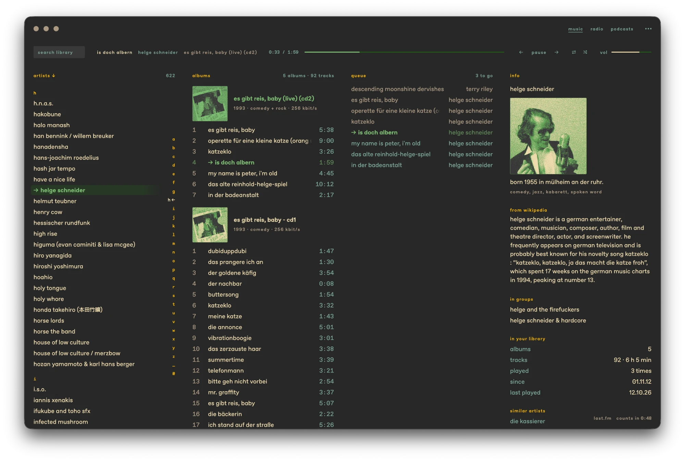
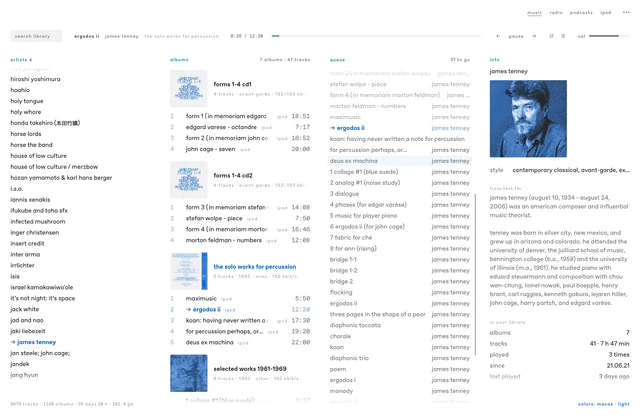
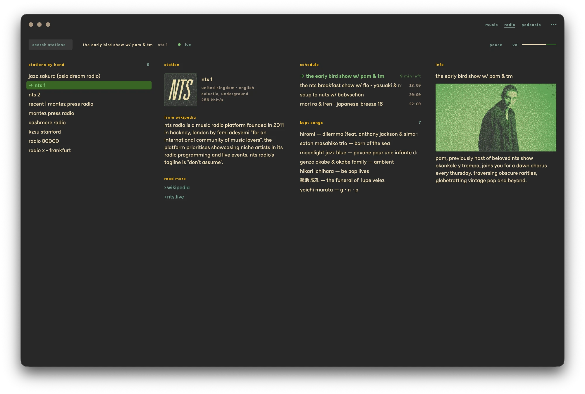
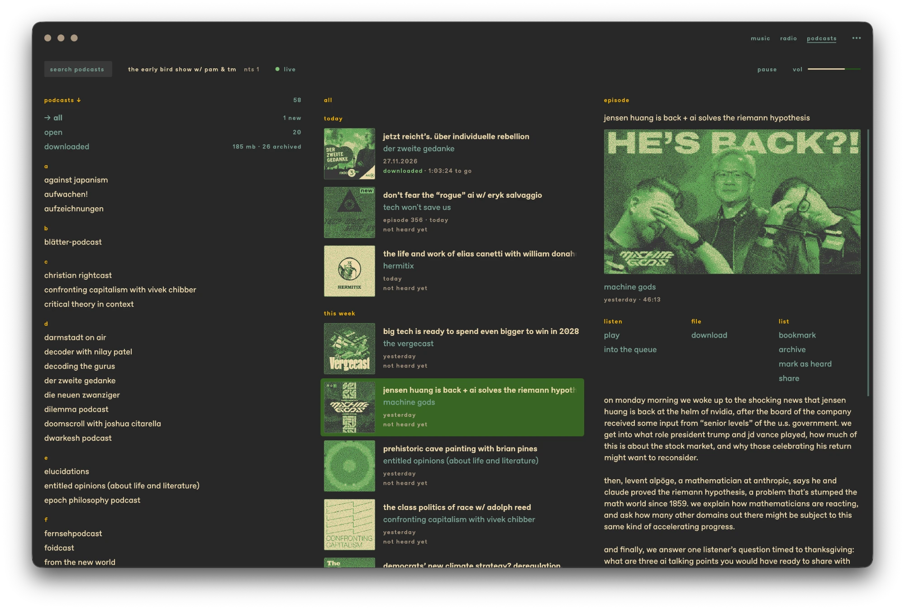
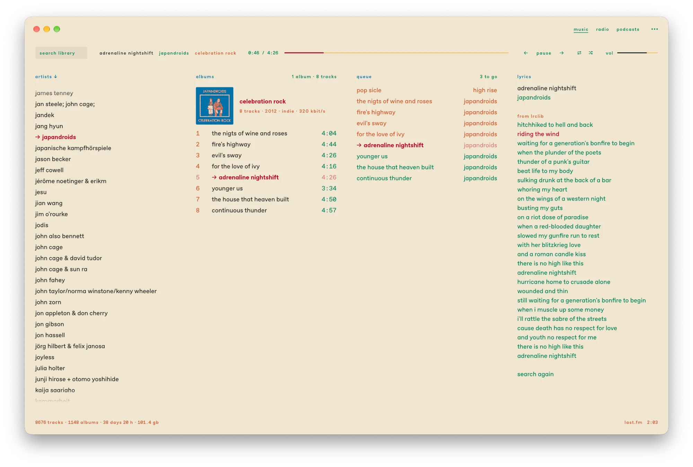
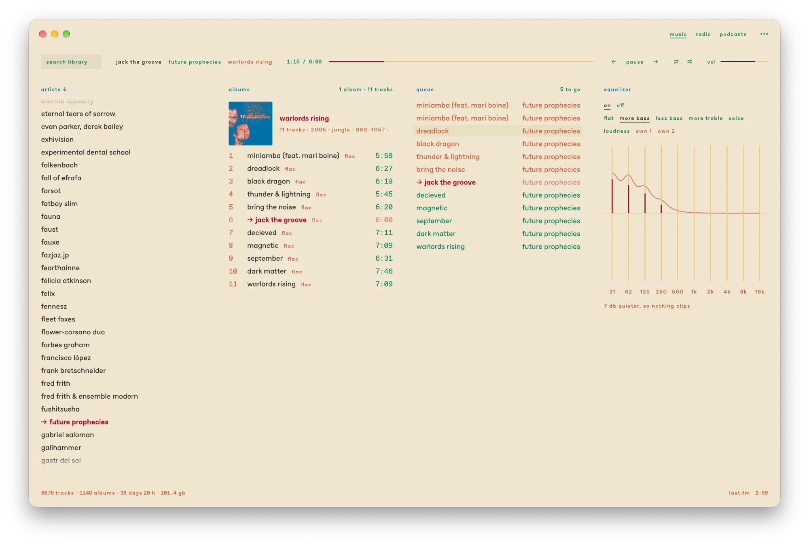
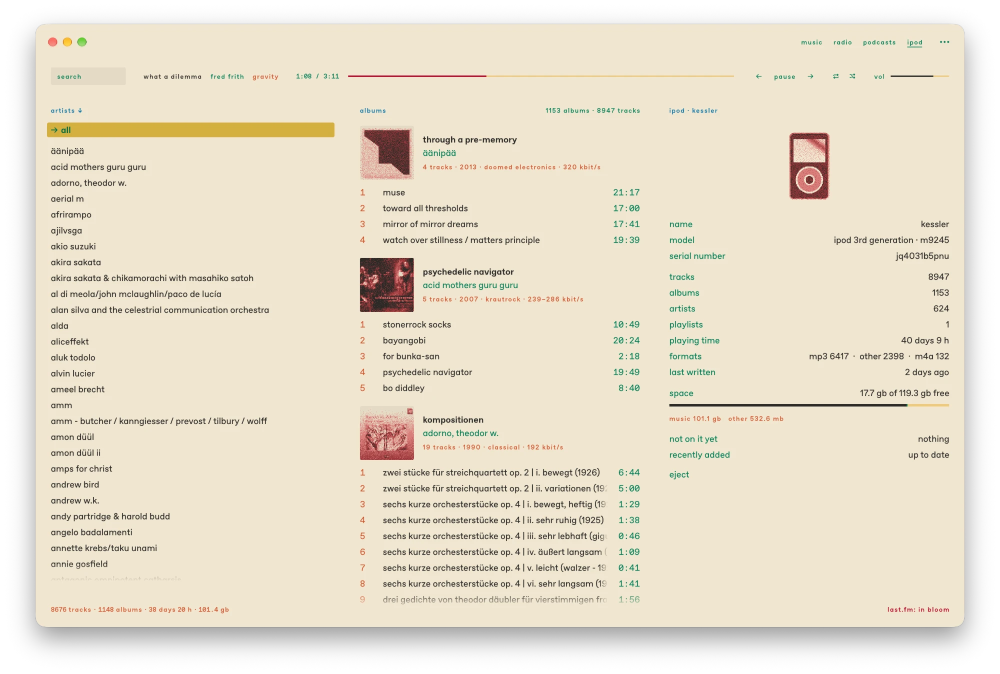
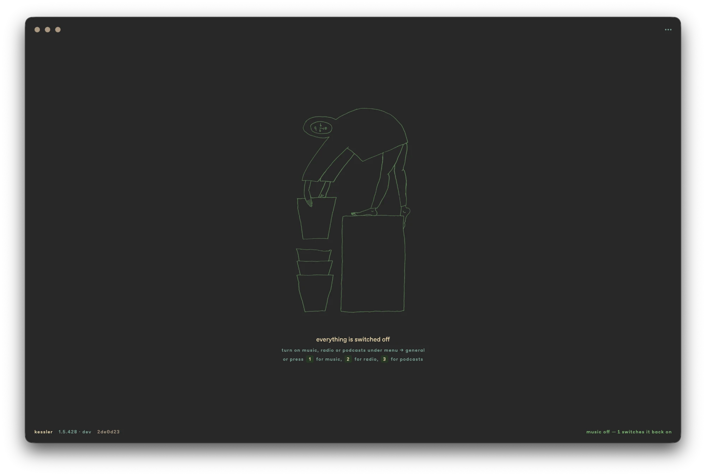
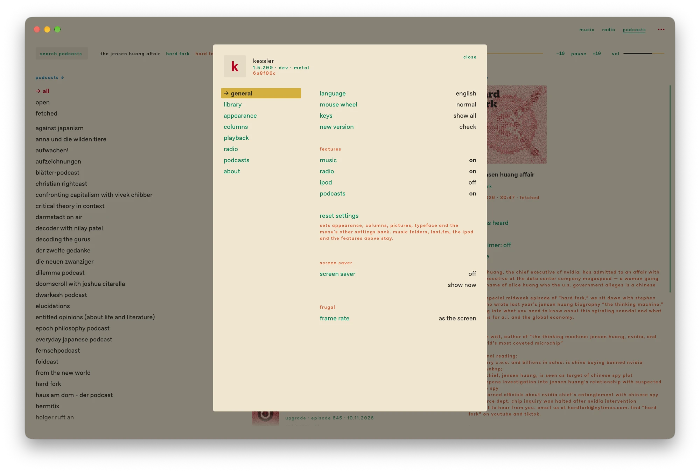
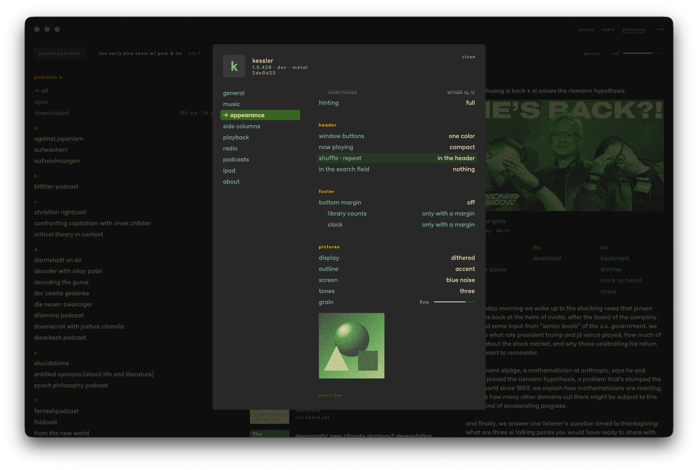

# kessler

<p align="center"></p>

kessler is my music player. it plays and manages local audio files, and it
does radio, podcasts and sync for the classic ipod too. i made it for the
keyboard: every function has a key, and you can work the whole window without
touching the mouse (the mouse works as well). it is set in muto, a typeface by
[rade matic](https://radematic.com) that comes with it. on a mac it also sits
in the menu bar. it runs on macos, linux (the raspberry pi too) and windows,
and it is written in rust with egui and sqlite.



<sub>music: albums, queue and the artist side by side</sub>

<p align="center"></p>

<p align="center">&nbsp;&nbsp;</p>

## what it does

- **keyboard.** every function has a key, in the music, the radio and the
  podcasts alike: moving, searching, queueing, tagging, the menu for a row,
  the settings. `?` shows them all.
- **typeface.** the window is set in muto, with muto mono for the figures, by
  [rade matic](https://radematic.com) and licensed to come with kessler. you
  can pick its alternates in the menu. asap comes along too, a rounded face
  whose width and weight you can set with a slider.
- **library.** reads mp3, aac, apple lossless (`.m4a`), flac, ogg vorbis, wav
  and aiff from one or more folders into a local database, with tags and
  covers. you can edit the tags in the window (composer, grouping, bpm and
  comment too), and every write is tried on a copy first. missing covers are
  looked up online, missing years and genres on musicbrainz.
- **views and layout.** artists, albums, tracks and the queue as columns, or
  the albums as headings in the track list, each with its dithered cover. a
  side column shows the ipod, the artist, the lyrics, the equalizer or the
  log. every column has its own key, and you can drag the dividers.
- **playback.** gapless, with loudness levelling, shuffle, repeat, a queue and
  saved lists. media keys on macos and linux (mpris). on linux also from the
  command line (`kessler toggle`, `kessler now`) with a notification per
  track, which is nice in tiling window managers.
- **menu bar.** on a mac the k sits in the menu bar: a click plays or pauses,
  a right click opens a small panel with the cover, the title, the buttons and
  the volume, so the window can stay hidden. on linux it sits in the tray.
- **ipod.** reads any ipod and syncs music to every model up to the 5.5g
  video. what the ipod can't play, like flac, is converted on the way. plays
  and ratings from the ipod come back into the library and to last.fm.
- **lyrics.** from the file's own tag or from lrclib; timed ones follow the
  song line by line.
- **radio.** off until you switch it on. any station radio browser knows, or
  a stream's address. what plays is shown, can be kept, scrobbled and looked
  up like a track.
- **podcasts.** follow a feed or find a show by name. new episodes come in the
  background, with downloads, chapters on the timeline, their own queue, and
  every episode picks up where you left it.
- **equalizer.** ten bands, presets and two of your own; it turns the whole
  down just enough that nothing clips.
- **only what you use.** music, radio, podcasts and the ipod can each be
  switched off, and what is off costs nothing.
- **artists.** picture, text, members and similar artists from musicbrainz,
  wikipedia and wikidata, kept locally and editable. „other artists“ shows
  who your artists keep naming and you don't have yet.
- **and also.** last.fm scrobbling (offline too), a vectorscope, a playing
  title whose letters can swell with the music, a screen saver, 50 colour
  schemes in light and dark pairs, and german, english and japanese.



<sub>radio: a station, its schedule and the songs kept</sub>



<sub>podcasts: a show, its episodes and the one playing</sub>



<sub>lyrics beside the queue</sub>



<sub>the equalizer</sub>



<sub>an ipod plugged in</sub>



<sub>everything switched off</sub>

all settings are in the menu (`m`):





## privacy

kessler collects nothing. no telemetry, no analytics, no crash reports, no
account, no ads, and nothing about you or your library is sent anywhere on its
own. it only goes online for something you asked for, and only to the place
that has it:

- **covers, years and genres:** when you ask for them. cover art archive, the
  itunes store and deezer for covers, musicbrainz for years and genres.
- **artist information and lyrics:** while their column is open. musicbrainz,
  wikidata, wikipedia and last.fm for the artist, lrclib for the words.
- **radio and podcasts:** only once switched on. the stations and feeds you
  chose, radio browser when you search for a station, apple's podcast
  directory when you search for a podcast.
- **last.fm:** only once you have signed in.
- **updates:** only when you click the row under `über`, one question to
  github.

every request only says `kessler` and its version; nothing that tells you,
your computer or your installation apart goes with it.

## get it running

you need a rust toolchain (`rustup`, stable), and on linux also
`libasound2-dev`.

```sh
cargo build --release
./target/release/kessler              # opens the window
./target/release/kessler scan ~/Music # imports a folder
```

on a mac, `./bundle/make-app.sh /Applications` builds `kessler.app`, and
`./bundle/make-app.sh --share` makes a zip for another mac, with the
typefaces that may travel with it. on linux (a raspberry pi too),
`./bundle/install-linux.sh` builds it and puts it in the start menu with its
icon. a signed and notarized disk image for the mac is always at
[kessler-macos.dmg](https://github.com/radiorauschen/kessler/releases/download/mac/kessler-macos.dmg).
the releases have ready-built packages for a raspberry pi
(`…-linux-arm64.tar.gz`) and a linux pc (`…-linux-x86_64.tar.gz`): unpack,
then `./install.sh`; see the manual.

muto (with muto mono for the figures) by rade matic comes with the repository
under its own licence, which allows it inside kessler only
(`fonts/Muto/LICENSE-muto.md`). [asap](https://github.com/Omnibus-Type/Asap)
and m plus 1 code for japanese are free (sil open font license). all of them
are in `fonts/` with their licences (see the
[manual](docs/manual.md#the-typeface)).

## keys

`?` shows all keys over the window. on linux, `cmd` is `ctrl`.

**playback**

| key | action |
| --- | --- |
| `space` | play / pause |
| `enter` | play the selection |
| `n` / `p` | next / previous track |
| `1` `2` `3` | music, radio, podcasts — switched on where they are off |
| `c` then `1` `2` `3` | switch music, radio or podcasts off |
| `shift` + `←` `→` | seek ten seconds |
| `,` / `.` | seek a minute back / forward |
| `+` / `−` | volume |
| `s` / `r` | shuffle / repeat |

**moving**

| key | action |
| --- | --- |
| `j` `k` / `↓` `↑` | row down / up |
| `h` `l` / `←` `→`, `tab` | previous / next column |
| `g` `g` / `shift` + `g` | to the top / bottom of the column |
| `shift` + `j` `k` | select several tracks |
| `esc` | select nothing |
| `cmd` + `a` | select all |
| `/` | search; `esc` ends it |
| `enter` / `tab` | from the search into the results |

**queue and lists**

| key | action |
| --- | --- |
| `a` / `shift` + `a` | queue at the end / as next |
| `w` | show the queue |
| `u` | lists instead of the queue |
| `shift` + `u` | open the next list |
| `d` / `backspace` | take a track out, delete a list |
| `cmd` + `backspace` | take a track out of the queue |
| `shift` + `d` twice | in the queue: clear it |
| `shift` + `j` `k` | in the queue: move the track or the selected block |
| `shift` + `↓` `↑` | in the queue: select several |

**editing**

| key | action |
| --- | --- |
| `e` | edit tags |
| right-click, `v` | menu for a track, an album or a list |

**window**

| key | action |
| --- | --- |
| `t` | the log |
| `i` | about the artist |
| `o` | other artists, not in your library yet |
| `b` | the screen saver, now |
| `y` | lyrics |
| `z` | the equalizer |
| `shift` + `t` | light ↔ dark |
| `shift` + `f` | next colour scheme |
| `alt` + `shift` + `f` | previous colour scheme |
| `f` | full screen |
| `cmd` + `+` `−` `0` | bigger / smaller / system size |
| `m` | open the menu |
| `h` `l`, `j` `k`, `enter` | in the menu: tabs ↔ rows, move, change (like the columns) |
| `?` | all keys |
| `q` `q` | quit |

## ipod

| model | sync |
| --- | --- |
| ipod 1g–4g, photo, 5g/5.5g video, mini, nano 1–2 | works |
| ipod shuffle 1g–4g | works, writes its `iTunesSD` (no voiceover) |
| ipod classic, nano 3g–4g | refused, because these need a signed database |
| nano 5g and later, touch, iphone | refused, because they use a different format |

kessler checks which model is plugged in before it writes anything. if it
doesn't recognise the model, it refuses. it has been run against a real 3g;
the other models only against their formats. its column renames it (`name`) and writes a
report to send along (`bericht speichern`, with ⌥ held).

## more

- the [manual](docs/manual.md) covers every view, every setting and every key
  in the config file.
- the [design](docs/design.md) says how the window looks and moves, if you
  want to add to it.
- the [changes](CHANGELOG.md), one summary per release.
- still missing: the signature for newer ipods, album art on the ipod,
  listenbrainz.

## thanks

to mattis, matthias, leo, niklas and rade, for their feedback and their
devices.

## licence

kessler is free software: you can pass it on and change it under the terms of
the [gnu general public license](LICENSE), version 3 or (at your choice) any
later version. it comes with no warranty.

my drawings in the menu and on the page kessler shows with everything
switched off are under their own terms, [cc by-nc-nd 4.0](LICENSE-drawing.md).
the motto under „über“ is a quotation, ascribed to people of the hfg ulm or
of the bauhaus. the typefaces in `fonts/` keep their own licences, and so do
the libraries kessler is built from (menu → über → `lizenzen`).

## support

if you get something out of kessler and want to give back, there are a few
ways:

- donate to [wikipedia](https://donate.wikimedia.org/), [musicbrainz](https://metabrainz.org/donate), [last.fm](https://www.last.fm/pro), [egui](https://github.com/sponsors/emilk) or the [rust foundation](https://rustfoundation.org/support-us/)
- support independent artists on [bandcamp](https://bandcamp.com) or buy directly from them
- buy a font from [radematic.com](https://radematic.com)
- have a look at the catalogue of my small independent publishing house and pick up a book at **[windparkbooks.de](https://www.windparkbooks.de)**
- buy us a coffee at [buymeacoffee.com/windparkbooks](https://buymeacoffee.com/windparkbooks)

found a bug, have an idea or a wish? open an issue or send a pr.

arigatou ne

<p align="center"></p>
