# kessler

<p align="center"></p>


kessler is a music player and library manager for local audio files, with
radio, podcasts and sync for the classic ipod. it is made for the keyboard:
every function has a key, and the whole window — music, radio, podcasts, the
menu — can be worked without touching the mouse, which works as well. it is
set in muto, a typeface by [rade matic](https://radematic.com) that comes
with it. on a mac it sits in the menu bar too, to be steered from there. it
runs on macos,
linux (including the raspberry pi) and windows, and is written in rust with
egui and sqlite.

<p align="center">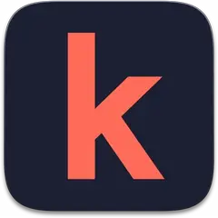</p>

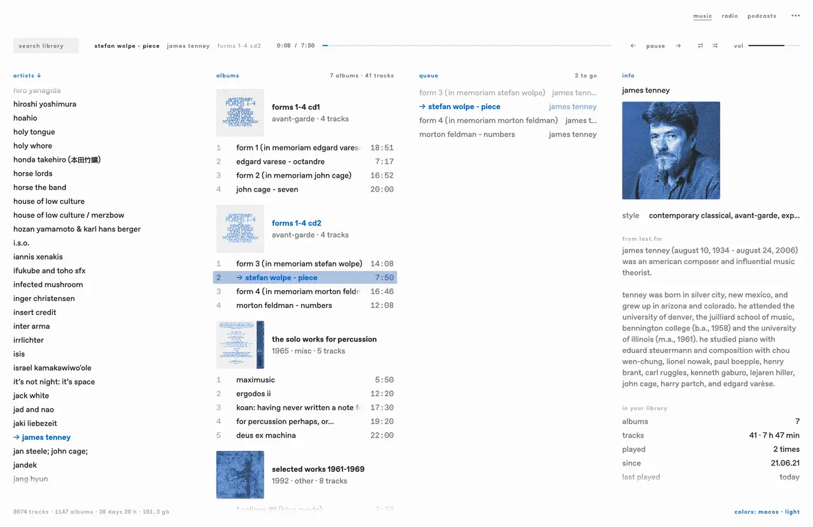


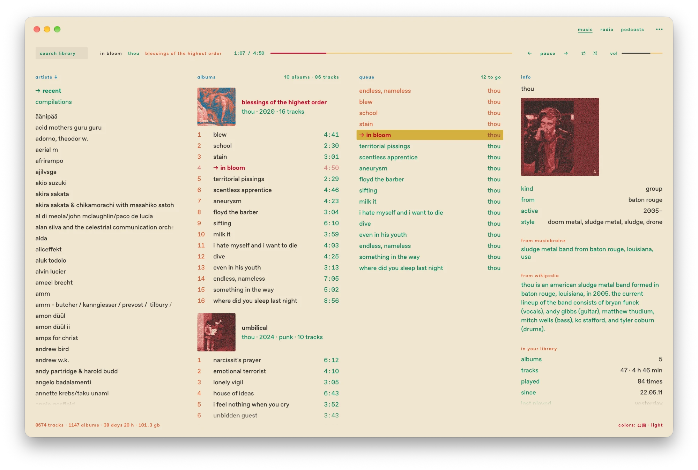

## features

- **keyboard.** every function has a key, in the music, the radio and the
  podcasts alike: moving, searching, queueing, tagging, the menu for a row,
  the settings. `?` shows them all. the mouse works as well.
- **typeface.** the window is set in muto, with muto mono for its figures —
  by [rade matic](https://radematic.com), and licensed to come with kessler. its alternates can be
  chosen in the menu. asap comes with it as well: a rounded face whose
  width can be set with a slider, for whoever prefers it condensed, and its
  weight too.
- **library.** reads mp3, aac and apple lossless (`.m4a`), flac, ogg vorbis,
  wav and aiff (aiff-c too) from one or more folders into a local database, with tags and
  covers. tags can be edited in the window, composer, grouping, bpm and
  comment included, and every write is checked on a copy first; missing covers are looked up
  online, missing years and genres on musicbrainz.
- **views.** artists, albums and tracks as columns, or the albums as headings
  in the track list, each with its dithered cover.
- **layout.** the window is a row of columns: artists, albums, tracks and the
  queue, plus an optional side column for the ipod, the artist information or
  the log. each column opens and closes with its own key; dividers can be
  dragged.
- **playback.** gapless, with loudness levelling, shuffle, repeat, a queue
  and saved lists. media keys on macos and on linux (mpris). on linux also
  from the command line (`kessler toggle`, `kessler now`) and with a
  notification per track — made for tiling window managers too.
- **menu bar.** on a mac, kessler's k stands in the menu bar: a click plays
  or pauses, a right click opens a small panel with the cover, title and
  artist of what plays, previous, play and next, and the volume — so the
  window can stay put away. on linux the same symbol stands in the panel's
  tray.
- **ipod.** reads any ipod and syncs music to every model up to the 5.5g
  video. formats the ipod cannot play, such as flac, are converted during the
  sync. what it played and rated on the way comes back into the library and
  to last.fm when it is plugged in.
- **lyrics.** the words of the song playing, from the file's own tag or from
  lrclib; timed ones follow the song line by line.
- **radio.** off until switched on, and empty until filled: any station
  radio browser knows, searched in the search field, or a stream's address,
  kept in a list; what plays is shown, kept, scrobbled and looked up like a track.
- **podcasts.** followed by a feed's address or found by name; new episodes
  in the background, downloads, chapters in the timeline, a queue of their
  own, and every episode taken up where it was left.
- **equalizer.** ten bands in a column of its own, with presets and two of
  one's own; it turns the whole down just far enough that nothing clips.
- **only what you use.** music, radio, podcasts and the ipod can each be
  switched off; what is off costs nothing.
- **artist information.** picture, text, members and similar artists from
  musicbrainz, wikipedia and wikidata, stored locally and editable.
- **other artists.** who your artists keep naming as similar and you don't
  have yet, counted from your own library.
- **other.** last.fm scrobbling with an offline queue, a vectorscope, a
  playing title in the queue whose letters can swell with the music, a
  screen saver (the vectorscope, or the song's lyrics filling the window), 50 colour schemes in light and dark pairs, german, english
  and japanese.

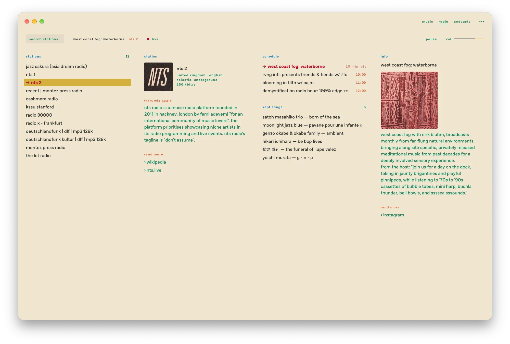

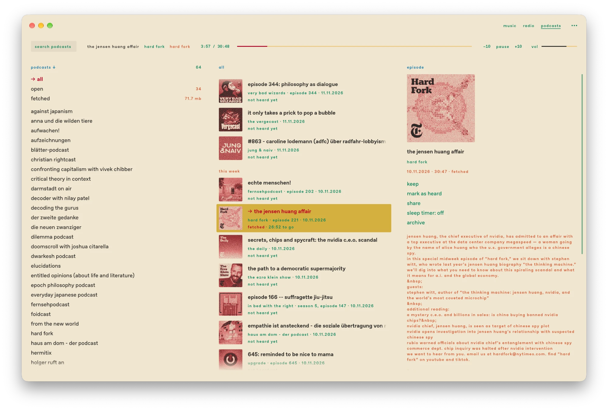

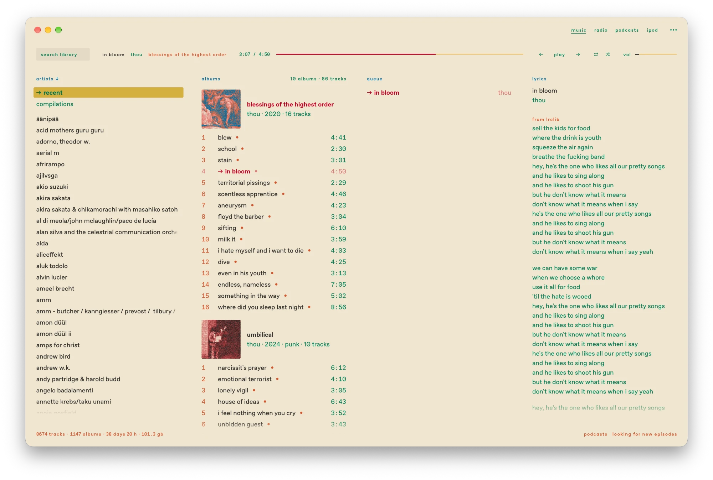

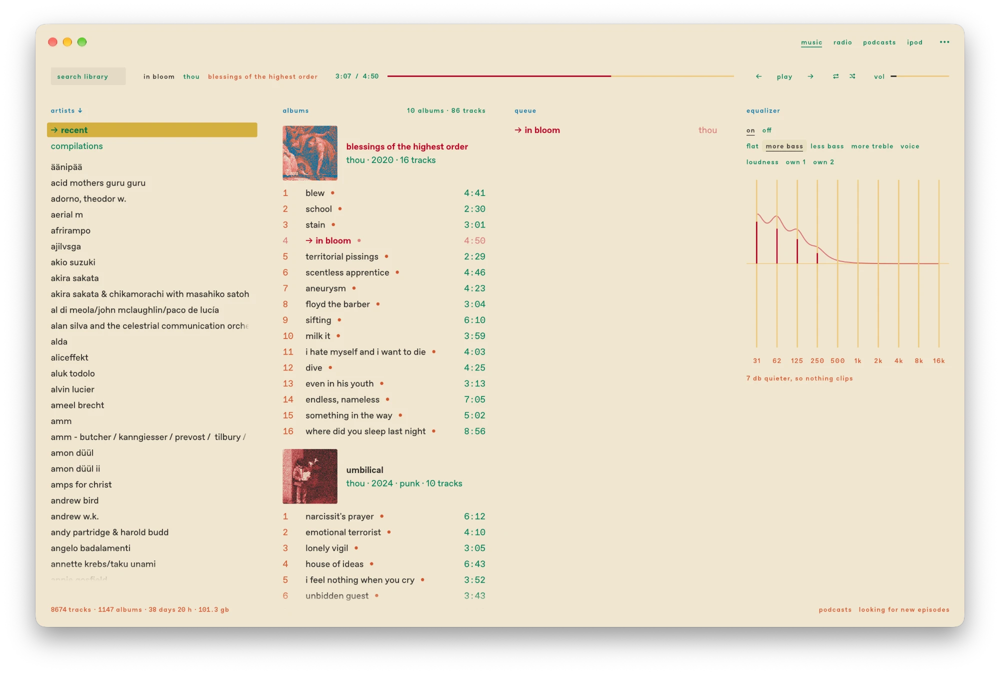

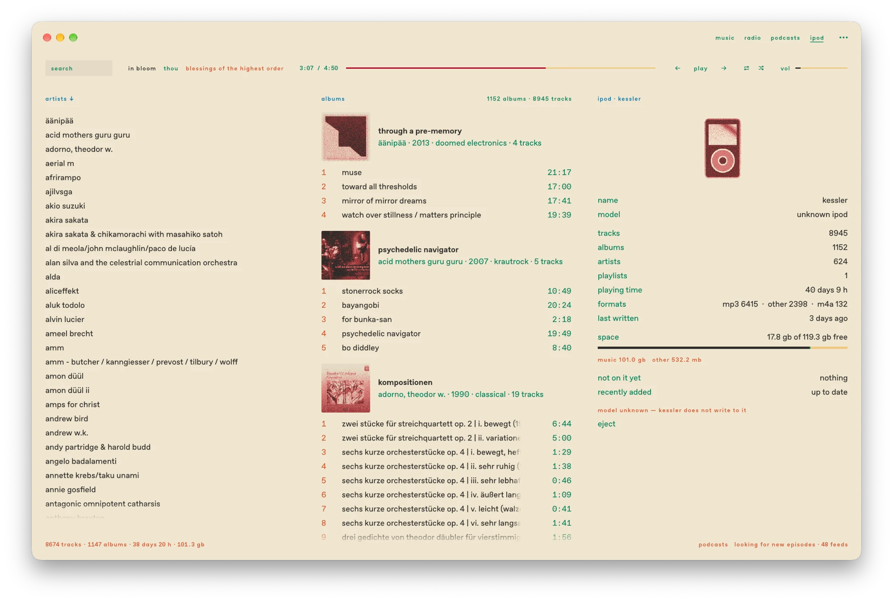

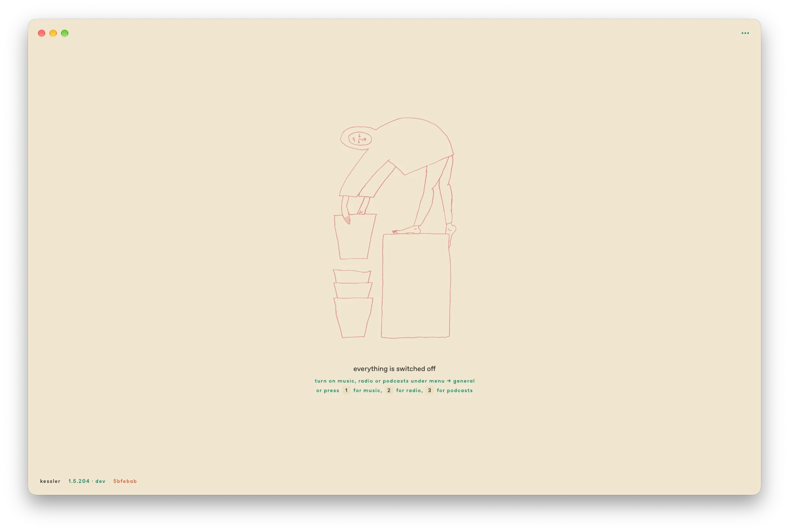

all settings are in the menu (`m`):

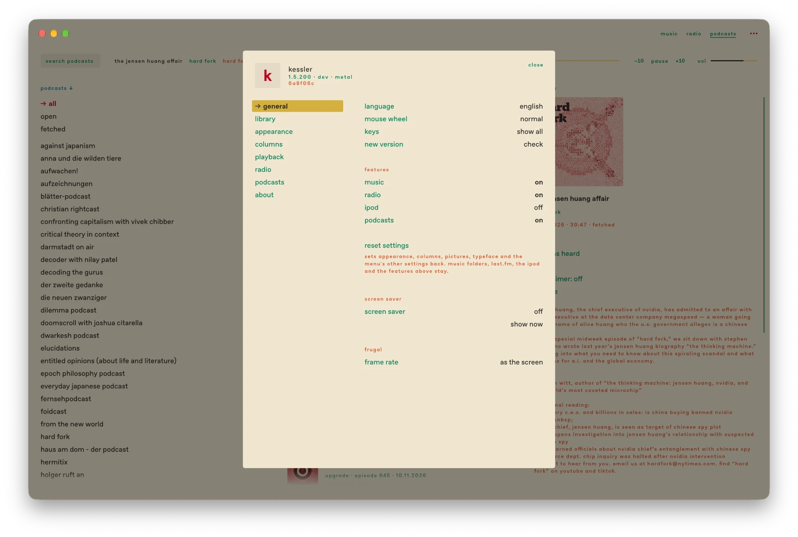

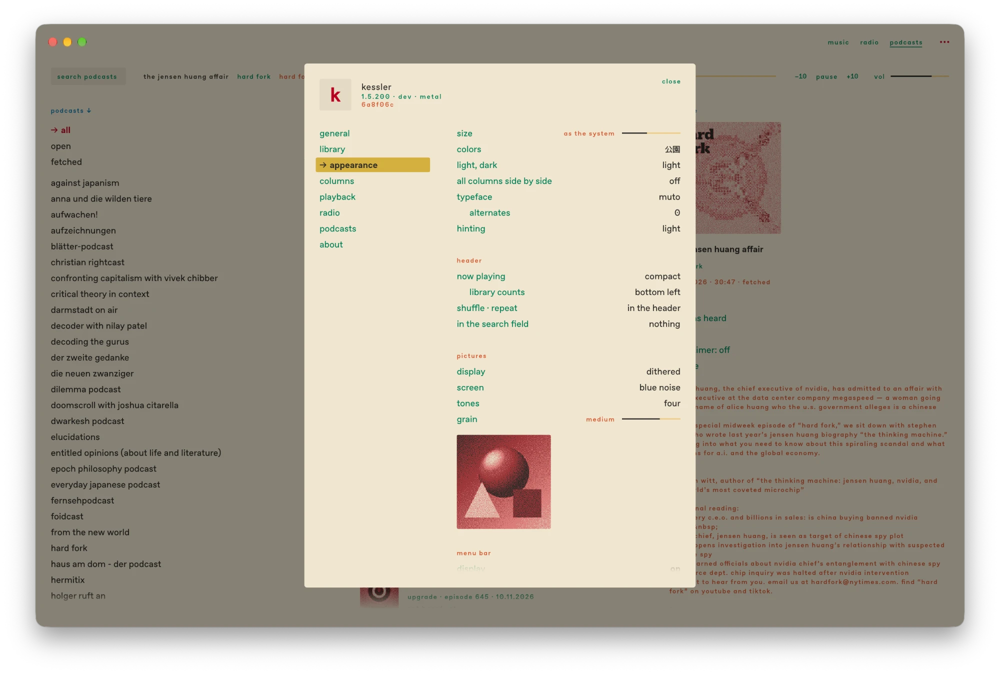

## privacy

kessler collects nothing. there is no telemetry, no analytics, no crash
reporting, no account and no advertising, and nothing about you or your
library is sent anywhere on its own. it goes online only for something you
asked for, and only to the place that has it:

- **covers, years and genres:** when you ask for them — cover art archive,
  the itunes store and deezer for covers, musicbrainz for years and genres.
- **artist information and lyrics:** while their column is open —
  musicbrainz, wikidata, wikipedia and last.fm for the artist, lrclib for
  the words.
- **radio and podcasts:** only once switched on — the stations and feeds you
  chose, radio browser when you search for a station, apple's podcast
  directory when you search for a podcast.
- **last.fm:** what you play is scrobbled only once you have signed in.
- **updates:** checked only when you click the row under `über`, one
  question to github.

each request carries only `kessler` and its version as its name; nothing
that tells you, your computer or your installation apart goes with it.

## get it running

you need a rust toolchain (`rustup`, stable). on linux you also need
`libasound2-dev`.

```sh
cargo build --release
./target/release/kessler              # opens the window
./target/release/kessler scan ~/Music # imports a folder
```

on a mac, `./bundle/make-app.sh /Applications` builds `kessler.app`, which you
can open with a double-click; `./bundle/make-app.sh --share` makes a zip for
another mac, with the typefaces that may travel with it. on linux — a raspberry pi too —
`./bundle/install-linux.sh` builds it and puts it in the start menu with its
icon. a signed and notarized disk image for the mac is always at
[kessler-macos.dmg](https://github.com/radiorauschen/kessler/releases/download/mac/kessler-macos.dmg).
releases have ready-built packages for a raspberry pi
(`…-linux-arm64.tar.gz`) and a linux pc (`…-linux-x86_64.tar.gz`): unpack,
then `./install.sh`; see the manual.

the window opens in muto (with muto mono for figures), by rade matic — it
comes with the repository under its own licence, which allows it inside
kessler only (`fonts/Muto/LICENSE-muto.md`). [asap](https://github.com/Omnibus-Type/Asap),
whose weights are all one width, with sliders for its width and weight, and
m plus 1 code for japanese are free (sil open font license). all of them are
in `fonts/`,
licences included (see the [manual](docs/manual.md#the-typeface)).

## keys

`?` shows all keys over the window. on linux, `cmd` is `ctrl`.

**playback**

| key | action |
| --- | --- |
| `space` | play / pause |
| `enter` | play the selection |
| `n` / `p` | next / previous track |
| `1` `2` `3` | music, radio, podcasts — switched on where they are off |
| `c` then `1` `2` `3` | switch music, radio or podcasts off |
| `shift` + `←` `→` | seek ten seconds |
| `,` / `.` | seek a minute back / forward |
| `+` / `−` | volume |
| `s` / `r` | shuffle / repeat |

**moving**

| key | action |
| --- | --- |
| `j` `k` / `↓` `↑` | row down / up |
| `h` `l` / `←` `→`, `tab` | previous / next column |
| `g` `g` / `shift` + `g` | to the top / bottom of the column |
| `shift` + `j` `k` | select several tracks |
| `esc` | select nothing |
| `cmd` + `a` | select all |
| `/` | search; `esc` ends it |
| `enter` / `tab` | from the search into the results |

**queue and lists**

| key | action |
| --- | --- |
| `a` / `shift` + `a` | queue at the end / as next |
| `w` | show the queue |
| `u` | lists instead of the queue |
| `shift` + `u` | open the next list |
| `d` / `backspace` | take a track out, delete a list |
| `cmd` + `backspace` | take a track out of the queue |
| `shift` + `d` twice | in the queue: clear it |
| `shift` + `j` `k` | in the queue: move the track or the selected block |
| `shift` + `↓` `↑` | in the queue: select several |

**editing**

| key | action |
| --- | --- |
| `e` | edit tags |
| right-click, `v` | menu for a track, an album or a list |

**window**

| key | action |
| --- | --- |
| `t` | the log |
| `i` | about the artist |
| `o` | other artists, not in your library yet |
| `b` | the screen saver, now |
| `y` | lyrics |
| `z` | the equalizer |
| `shift` + `t` | light ↔ dark |
| `shift` + `f` | next colour scheme |
| `alt` + `shift` + `f` | previous colour scheme |
| `f` | full screen |
| `cmd` + `+` `−` `0` | bigger / smaller / system size |
| `m` | open the menu |
| `h` `l`, `j` `k`, `enter` | in the menu: tabs ↔ rows, move, change (like the columns) |
| `?` | all keys |
| `q` `q` | quit |

## ipod

| model | sync |
| --- | --- |
| ipod 1g–4g, photo, 5g/5.5g video, mini, nano 1–2 | works |
| ipod shuffle 1g–4g | works, writes its `iTunesSD` (no voiceover) |
| ipod classic, nano 3g–4g | refused, because these need a signed database |
| nano 5g and later, touch, iphone | refused, because they use a different format |

kessler checks which model is plugged in before it writes anything. if it
doesn't recognise the model, it refuses. it has been run against a real 3g;
the other models only against their formats. its column renames it (`name`) and writes a
report to send along (`bericht speichern`, with ⌥ held).

## more

- the [manual](docs/manual.md) covers every view, every setting and every key
  in the config file.
- the [design](docs/design.md) says how the window looks and moves, for
  whoever adds to it.
- the [changes](CHANGELOG.md) are in german, the way the window shows them.
- still missing: the signature for newer ipods, album art on the ipod,
  listenbrainz.

## thanks

to mattis, matthias, leo, niklas and rade, for their feedback and their devices.

## licence

kessler is free software: you can pass it on and change it under the terms
of the [gnu general public license](LICENSE), version 3 or (at your choice)
any later version. it comes with no warranty.

the drawings in the menu and on the page kessler shows with everything
switched off are by felix h-w and under their own terms, [cc by-nc-nd
4.0](LICENSE-drawing.md). the motto under „über" is a quotation, ascribed
to people of the hfg ulm or of the bauhaus. the
typefaces in `fonts/` keep their own licences (sil open font license 1.1),
and so do the libraries kessler is built from (menu → über → `lizenzen`).

## support

If you get something out of **kessler** and want to give back, there are several ways you can help:

- Donate to [Wikipedia](https://donate.wikimedia.org/), [MusicBrainz](https://metabrainz.org/donate), [Last.fm](https://www.last.fm/pro), [egui](https://github.com/sponsors/emilk), or the [Rust Foundation](https://rustfoundation.org/support-us/)
- Support independent artists on [Bandcamp](https://bandcamp.com) or buy directly from them
- Buy a font from [radematic.com](https://radematic.com)
- Check out the catalog of my small independent publishing house and pick up a book at **[windparkbooks.de](https://www.windparkbooks.de)**
- Buy us a coffee at [buymeacoffee.com/windparkbooks](https://buymeacoffee.com/windparkbooks)

Found a bug, have a feature request, or just want to share some ideas? Feel free to open an issue or submit a PR!

arigatou ne

<p align="center"></p>
